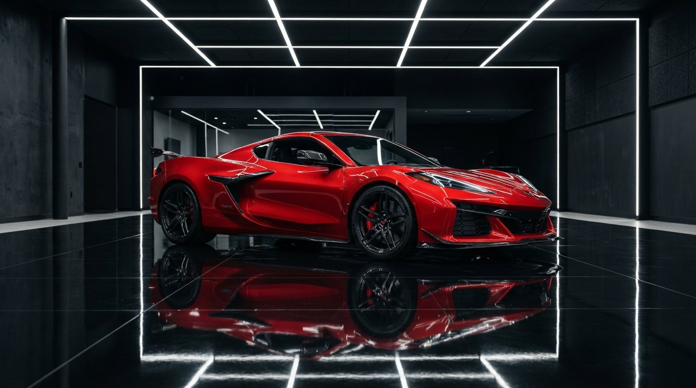

# ⚡ LUMEN · Performance Cars

Web ficticia de un showroom de deportivos en Madrid, creada como proyecto de portfolio. Está pensada como una experiencia visual: las luces del showroom se encienden con el scroll y cada coche se presenta con sus especificaciones señaladas sobre la foto.

**🔗 [Ver la web en vivo](https://sergioperez3.github.io/lumen/)**

## ✨ Funcionalidades

- **Intro con scroll**: el showroom empieza a oscuras y, al bajar, se encienden las luces mientras la cámara rodea el coche. Un velocímetro sube de 0 a 300 km/h. En escritorio se usa un vídeo y en móvil una secuencia de 81 fotogramas dibujados en `canvas`.
- **Showroom interactivo**:
  - Flechas SVG que se dibujan desde partes del coche hasta sus especificaciones, en tres pestañas (Rendimiento, Exterior, Equipamiento).
  - Transición con barrido de luz entre coches e inclinación 3D al mover el ratón.
  - El color de acento de toda la web cambia según el coche elegido.
  - Filtros (Deportivos, SUV, Berlinas), navegación con flechas, teclado y gesto de deslizar en móvil.
  - Potencia, par, 0-100 y velocidad máxima con contadores y barras animadas.
- **Comparador cara a cara** con barras animadas y el ganador marcado en cada dato.
- **Interior con zoom ligado al scroll** ("Siéntate dentro").
- **Llanta que gira** con la velocidad del scroll, con indicador de RPM.
- **Simulador de financiación**: entrada, plazo y cuota mensual calculada con la fórmula de amortización francesa.
- **Reserva de prueba de conducción**: calendario, franjas horarias ocupadas según coche y día, y formulario con confirmación.
- **Mapa** de Google Maps y diseño responsive con versión específica para móvil.

## 🛠️ Tecnologías

- HTML5, CSS3 (custom properties, sticky, clip-path, backdrop-filter) y JavaScript vanilla, sin frameworks.
- SVG generado dinámicamente para las flechas de especificaciones y el velocímetro.
- `IntersectionObserver` para las animaciones de entrada.
- FFmpeg para recodificar el vídeo (todos los fotogramas clave) y extraer la secuencia de imágenes para móvil.

## 🎨 Imágenes y vídeo

- Imágenes generadas con IA (Google Gemini) a partir de prompts diseñados para que todos los coches aparezcan en el mismo showroom.
- Vídeo de la intro generado con Kling AI a partir de dos imágenes (showroom apagado y encendido).

## ⚠️ Aviso

LUMEN es un concesionario inventado: no es oficial ni tiene relación con ninguna marca. Los nombres de marcas y modelos pertenecen a sus propietarios. Datos técnicos y precios orientativos.

---

Proyecto de portfolio · Diseño y desarrollo: **Sergio Pérez**
